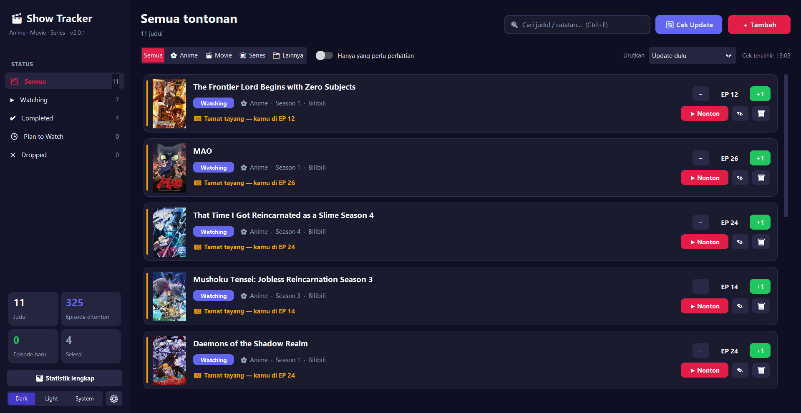
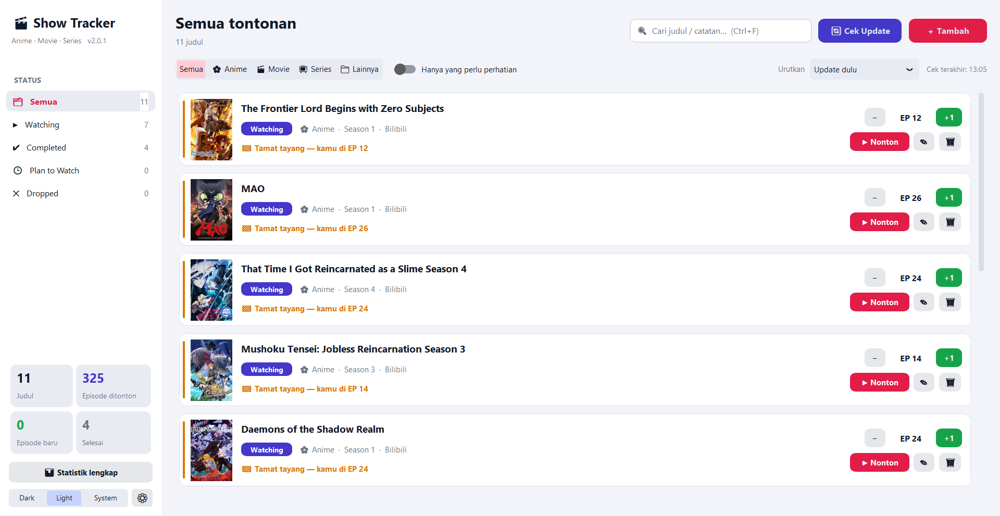
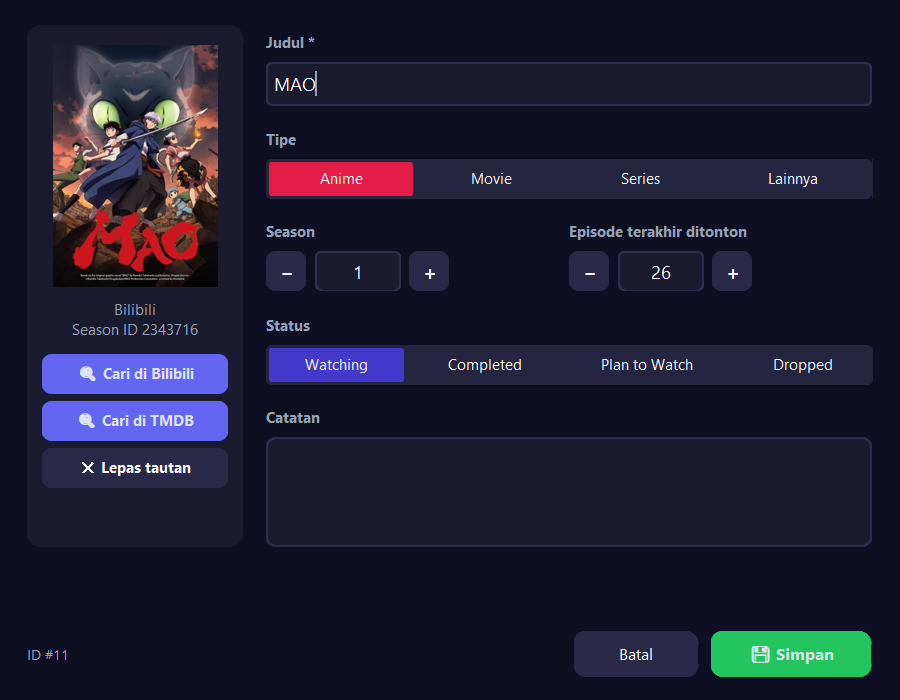
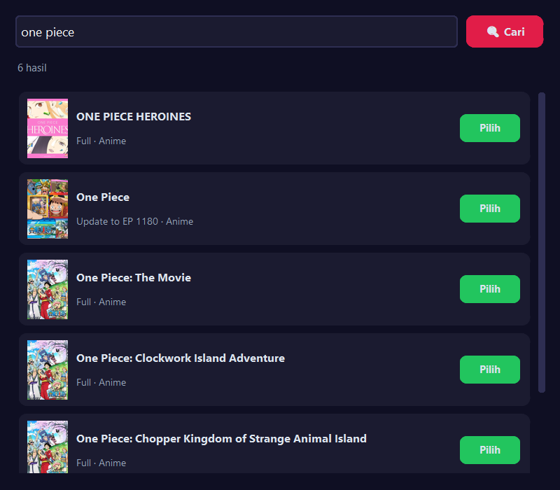
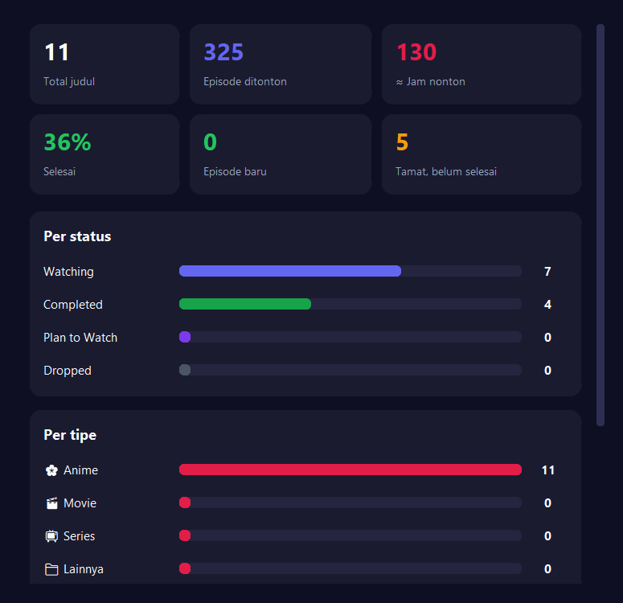

<div align="center">

# 🎬 Anime & Show Tracker

**Catat tontonan Anime, Film, dan Series dalam satu aplikasi. Aplikasi ini memberi tahu kamu begitu episode baru rilis.**

[](CHANGELOG.md)
[](https://www.python.org/)
[](#-instalasi)
[](https://github.com/TomSchimansky/CustomTkinter)

[-00A1D6?style=flat-square&logo=bilibili&logoColor=white)](https://www.bilibili.tv/)
[](https://www.themoviedb.org/)



[Fitur](#-fitur) · [Screenshot](#-screenshot) · [Instalasi](#-instalasi) · [TMDB](#-mengaktifkan-tmdb-opsional) · [Build .exe](#-build-exe) · [Changelog](CHANGELOG.md)

</div>

---

## ✨ Fitur

<table>
<tr>
<td width="50%" valign="top">

### 🔔 Tidak ketinggalan episode
- Episode terbaru dicek otomatis di background, dengan interval **15 menit sampai 6 jam**.
- **Notifikasi Windows** muncul begitu episode baru rilis, tanpa spam setiap kali aplikasi dibuka.
- Penanda warna di setiap kartu:
  - 🟢 **ada episode baru**
  - 🟠 **sudah tamat, belum selesai ditonton**
  - 🔵 **film sudah rilis**
  - ✅ **up-to-date**, plus jadwal episode berikutnya

</td>
<td width="50%" valign="top">

### ▶️ Langsung nonton
- Tombol **Nonton** membuka **episode berikutnya** di Bilibili, tepat di episode yang kamu tuju.
- Kalau episodenya belum rilis atau anime sudah tamat, kamu diberi tahu, dengan tawaran menandainya *Completed*.
- Tombol **+1 / −** untuk update episode dalam satu klik.

</td>
</tr>
<tr>
<td valign="top">

### 🖼️ Tampilan modern
- Kartu dengan **poster otomatis** dari Bilibili/TMDB.
- Mode **Dark / Light / System**.
- Tampil tajam di layar HiDPI.

</td>
<td valign="top">

### 🌐 Dua sumber data
- **Bilibili (Bstation)** untuk anime: cari dan tautkan langsung dari aplikasi.
- **TMDB** untuk film dan series: deteksi episode baru per season dan tanggal rilis film.

</td>
</tr>
<tr>
<td valign="top">

### 🔎 Filter & urutan
- Filter **status** dan **tipe** (Anime / Movie / Series / Lainnya).
- **Pencarian live** judul dan catatan.
- Filter *"Hanya yang perlu perhatian"*.
- Urutan: *Update dulu, Terbaru, Terakhir diubah, Judul A–Z, Status*.

</td>
<td valign="top">

### 📊 Statistik
- Total judul, episode ditonton, dan **perkiraan jam nonton**.
- Persentase selesai.
- Grafik per status, per tipe, dan per sumber data.

</td>
</tr>
</table>

> 💾 **Data aman.** Semua data disimpan lokal di SQLite di sebelah `.exe`. Saat upgrade dari versi lama, database **otomatis dibackup** dulu.

## 📸 Screenshot

<div align="center">

| Mode gelap | Mode terang |
|:---:|:---:|
|  |  |

| Tambah / edit tontonan | Cari di Bilibili | Statistik |
|:---:|:---:|:---:|
|  |  |  |

</div>

## 🚀 Instalasi

> **Butuh:** Windows 10/11 dan Python **3.10+**

```bash
git clone https://github.com/irsanrochendi/anime-tracker.git
cd anime-tracker
python -m venv venv
venv\Scripts\activate
pip install -r requirements.txt
python tracker.py
```

### Cara pakai singkat
1. Klik **＋ Tambah** (`Ctrl+N`), lalu isi judulnya.
2. Klik **🔍 Cari di Bilibili** (anime) atau **🔍 Cari di TMDB** (film/series), pilih hasilnya, lalu poster dan info episode akan terisi otomatis.
3. Setiap selesai nonton, klik **+1**. Saat mau nonton lagi, klik **▶ Nonton**.

### ⌨️ Shortcut

| Tombol | Fungsi |
|---|---|
| `Ctrl` + `N` | Tambah tontonan |
| `Ctrl` + `F` | Cari |
| `F5` | Cek update episode |
| `Ctrl` + `Enter` | Simpan form |
| `Esc` | Tutup dialog |
| *Double-click* kartu | Edit |

## 🔑 Mengaktifkan TMDB (opsional)

TMDB dipakai untuk film dan series di luar Bilibili. API key-nya **gratis**:

1. Daftar di [themoviedb.org](https://www.themoviedb.org/), lalu **verifikasi email**.
2. Buka [Settings → API](https://www.themoviedb.org/settings/api) → **Create** → **Developer**, lalu isi formulirnya. Untuk *Application URL*, pakai URL lengkap seperti `https://github.com/<username>/anime-tracker`.
3. Di aplikasi, buka **⚙ Pengaturan**, tempel **API Key** atau **API Read Access Token**, klik **Tes**, lalu **Simpan**.

> 🔒 API key disimpan di `settings.json` di komputer kamu dan **tidak ikut ter-commit** ke git.

## 📦 Build `.exe`

```bash
python -m PyInstaller AnimeTracker.spec --noconfirm
```

Hasilnya `dist/AnimeTracker.exe`, satu file tanpa perlu instal Python. Versi aplikasi ikut tertanam di metadata file (*Properties → Details*). Database, `settings.json`, dan folder `posters/` dibuat di sebelah `.exe`.

<details>
<summary><b>🔄 Upgrade dari versi 1.x</b></summary>

<br>

Tidak ada langkah tambahan. Saat pertama dibuka, versi 2 menambah kolom baru ke database dan **membuat backup** `tracker_db.sqlite.bak-<tanggal>` lebih dulu. Poster untuk anime yang sudah terhubung ke Bilibili diunduh otomatis pada pengecekan update pertama.

</details>

<details>
<summary><b>🧩 Struktur kode</b></summary>

<br>

```
tracker.py                 entry point (dipakai juga oleh PyInstaller)
animetracker/
├── config.py              path data, konstanta, settings.json
├── db.py                  SQLite: migrasi + CRUD
├── logic.py               logika murni: status episode, notifikasi, tombol Nonton
├── updater.py             cek update di background + notifikasi Windows
├── posters.py             download & cache poster
├── sources/
│   ├── bilibili.py        Bilibili Web API
│   └── tmdb.py            TMDB API v3
└── ui/
    ├── app.py             jendela utama
    ├── widgets.py         kartu show, stepper, cache gambar
    ├── dialogs.py         form, pencarian, pengaturan, statistik
    └── theme.py           palet warna light/dark
tests/                     unit test
```

</details>

<details>
<summary><b>🧪 Menjalankan test</b></summary>

<br>

```bash
python -m unittest discover -s tests -t .
```

</details>

## 🛠️ Dibangun dengan

[Python](https://www.python.org/) · [CustomTkinter](https://github.com/TomSchimansky/CustomTkinter) · SQLite · [Pillow](https://python-pillow.org/) · [win11toast](https://github.com/GitHub30/win11toast) · [PyInstaller](https://pyinstaller.org/)

<sub>Data anime dari Bilibili (Bstation). Data film & series dari <a href="https://www.themoviedb.org/">TMDB</a>. Aplikasi ini menggunakan TMDB API tetapi tidak didukung atau disertifikasi oleh TMDB. Aplikasi pribadi, tidak berafiliasi dengan Bilibili.</sub>

---

<div align="center">

Dibuat dengan ❤️ untuk para penonton anime. Lihat perubahan terbaru di **[CHANGELOG](CHANGELOG.md)**.

</div>
